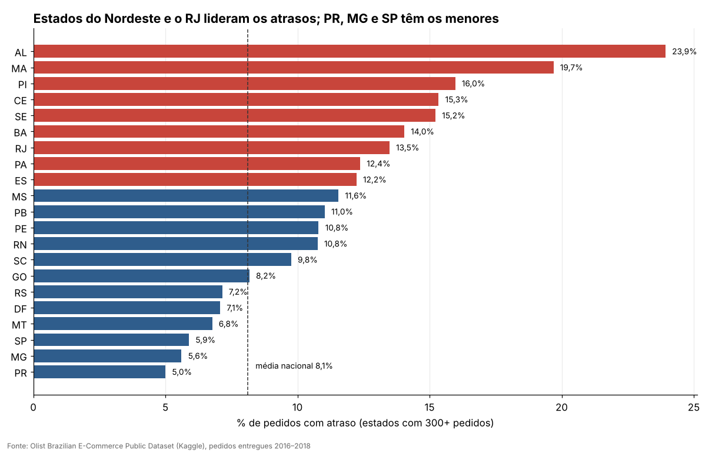

# Desempenho de entregas no e-commerce brasileiro: onde e por que os pedidos atrasam

Análise de dados de logística feita com **SQL (DuckDB) + Python**, sobre 96 mil pedidos reais entregues pela Olist entre 2016 e 2018.

**Pergunta de negócio:** quanto os pedidos atrasam, onde o tempo se perde e quanto o atraso custa em satisfação do cliente?

## Resultado em 30 segundos

| Indicador | Valor |
|---|---|
| Pedidos entregues analisados | 96.455 |
| Entregas com atraso (depois do prazo prometido) | **8,1%** |
| Prazo prometido ao cliente (médio) | 23,8 dias |
| Prazo real de entrega (médio) | 12,6 dias |
| Nota média do cliente | 4,16 |



## O que a análise mostra

1. **O prazo prometido é folgado, mas o atraso concentra o estrago.** Em média o prazo prometido é 11 dias maior que o prazo real, e só 8,1% dos pedidos atrasam. Mesmo assim, quem atrasa sofre muito (ver item 4).
2. **O atraso tem picos, não é constante.** Ficou entre 3% e 8% de janeiro a outubro de 2017, mas chegou a **14,3% em novembro/2017** e a **21,4% em março/2018** ([gráfico](graficos/01_atraso_por_mes.png)). A base não informa a causa desses picos.
3. **A região do cliente pesa muito.** Alagoas (23,9%), Maranhão (19,7%) e Piauí (16,0%) têm os maiores índices de atraso. Paraná (5,0%), Minas (5,6%) e São Paulo (5,9%) têm os menores. Nos estados analisados, atraso, prazo médio e frete andam juntos (correlação de 0,79 entre atraso e dias de entrega).
4. **O gargalo está na transportadora.** Pedidos que atrasaram passaram em média **25,7 dias** com a transportadora, contra 7,9 dos pedidos no prazo (mais de 3 vezes). Na etapa do vendedor (até postar o pedido) a diferença é de 5,3 contra 2,6 dias ([gráfico](graficos/03_gargalo_por_etapa.png)).
5. **O cliente tolera pouco atraso.** Com até 3 dias de atraso a nota média cai de 4,29 para 3,75. Com 4 a 7 dias cai para 2,30, e acima de 7 dias fica em 1,7 ([gráfico](graficos/04_impacto_na_nota.png)). Cerca de **5% dos pedidos** atrasaram mais de 3 dias e são justamente os que mais destroem a satisfação.
6. **O atraso é espalhado entre os vendedores.** Entre os 236 vendedores com 100+ itens, os 20% que mais atrasam em volume respondem por 58% dos itens atrasados, mas também por 50% do volume. Ou seja, não é um problema de "poucos vendedores ruins" ([gráfico](graficos/05_concentracao_vendedores.png)).
7. **A categoria do produto explica pouco.** Entre as categorias com 500+ itens, o atraso fica entre 5% e 10%. A exceção em prazo é `office_furniture`, com 20,8 dias de entrega e nota 3,51.

## Recomendações (para uma operação logística)

Estas recomendações vêm dos números acima. A relação entre as variáveis é de correlação: a base não prova a causa.

- **Atacar os atrasos longos (mais de 3 dias), não a média.** São cerca de 5% dos pedidos e concentram a queda de nota.
- **Rever transportadoras e rotas do Nordeste** (AL, MA, PI, CE, SE, BA) e do Rio de Janeiro, onde o índice de atraso fica entre 12% e 24%, contra 8,1% na média nacional.
- **Planejar capacidade antes dos picos** (como o de novembro) e acompanhar o índice de atraso por mês.
- **Prometer prazos por estado.** Hoje a folga média é grande, mas isso não evita atraso onde a transportadora é lenta.

## Como o projeto está organizado

```
sql/                    consultas SQL (uma por pergunta de negócio)
  01_base_entregas.sql    base analítica: 1 linha por pedido entregue
  02 a 08                 indicadores, mês, estado, etapas, nota, categoria, vendedor
rodar_sql.py            roda o SQL sobre os CSVs e salva em resultados/
gerar_graficos.py       gera os gráficos (graficos/) e o painel (painel.html)
resultados/             tabelas finais em CSV
graficos/               gráficos em PNG
painel.html             painel interativo (abrir no navegador)
dados/                  pasta para os CSVs da Olist (não vão para o GitHub)
```

## Como reproduzir

1. Baixe a base no Kaggle: [Brazilian E-Commerce Public Dataset by Olist](https://www.kaggle.com/datasets/olistbr/brazilian-ecommerce) e coloque os 9 arquivos `.csv` na pasta `dados/`.
2. Instale as bibliotecas: `pip install -r requirements.txt`
3. Rode a análise: `python rodar_sql.py`
4. Gere os gráficos e o painel: `python gerar_graficos.py`

## Definições usadas

- **Pedido analisado:** status "entregue", com datas de aprovação, postagem e entrega preenchidas.
- **Atraso:** pedido entregue **depois** da data estimada que a Olist informou ao cliente.
- **Etapas do prazo:** aprovação do pagamento, vendedor (até entregar à transportadora) e transportadora (até o cliente).
- **Nota:** média das avaliações do pedido (1 a 5). Só considera pedidos avaliados.

## Limitações

- Dados de 2016 a 2018 de um único marketplace. Servem para estudar o método, não para descrever a logística de hoje.
- A base não traz o motivo dos atrasos (greves, clima, falta de estoque etc.), então os picos ficam sem explicação.
- Estados com menos de 300 pedidos, categorias com menos de 500 itens e vendedores com menos de 100 itens ficaram de fora das comparações.
- A nota só existe para quem respondeu à pesquisa, o que pode enviesar o resultado.
- Não usei o arquivo de geolocalização (distância entre vendedor e cliente). É o próximo passo natural.

## Próximos passos

- Calcular a distância vendedor–cliente e medir quanto dela explica o atraso.
- Criar um modelo simples para prever quais pedidos têm mais risco de atrasar.
- Publicar o painel online (GitHub Pages).

## Fonte e licença

- **Dados:** Olist, [Brazilian E-Commerce Public Dataset](https://www.kaggle.com/datasets/olistbr/brazilian-ecommerce), licença [CC BY-NC-SA 4.0](https://creativecommons.org/licenses/by-nc-sa/4.0/). Os dados brutos não estão neste repositório. Os gráficos e tabelas resumidas seguem a mesma licença (uso não comercial, com atribuição à Olist).
- **Código:** licença MIT (arquivo `LICENSE`).

## Autor

**Luis Carlos Machado Soares**: profissional de logística e operações em transição para análise de dados.
