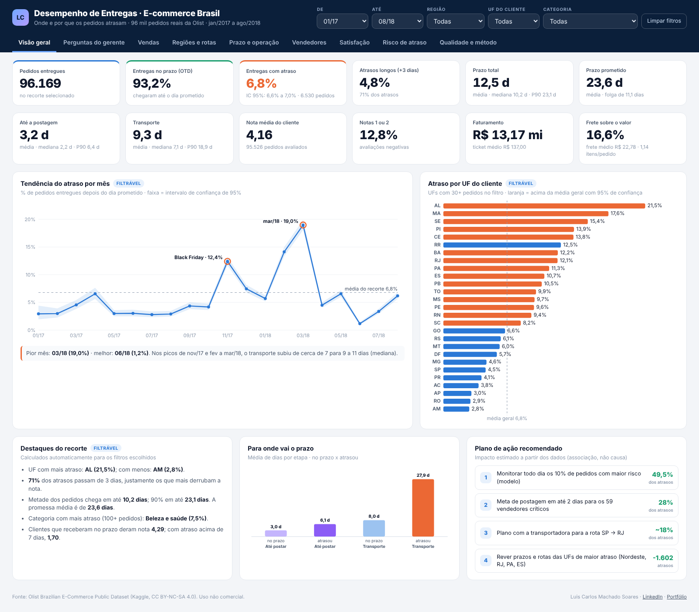
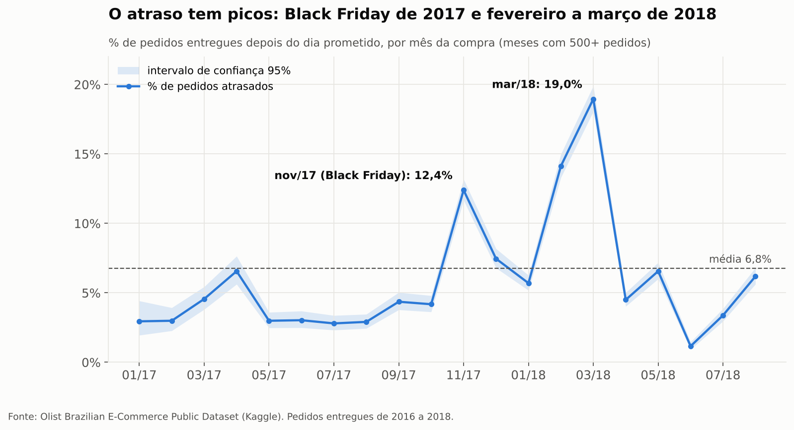
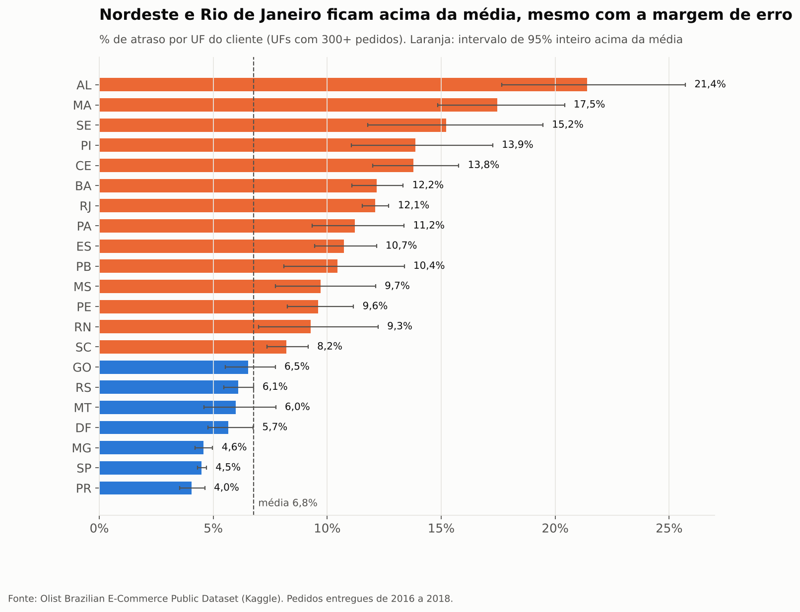
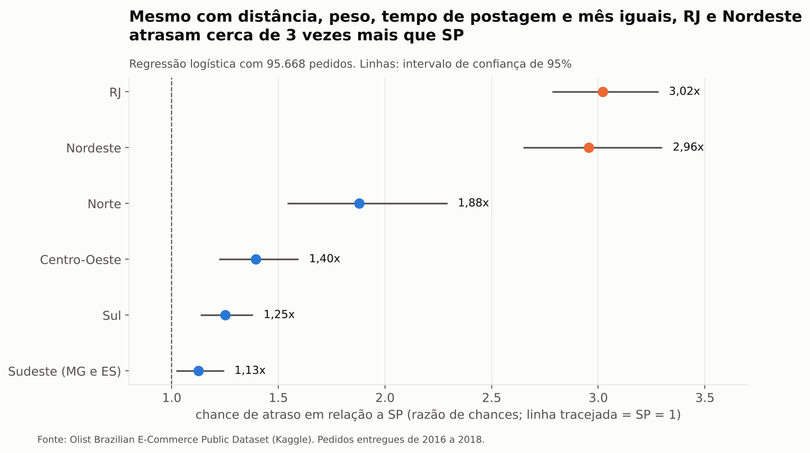
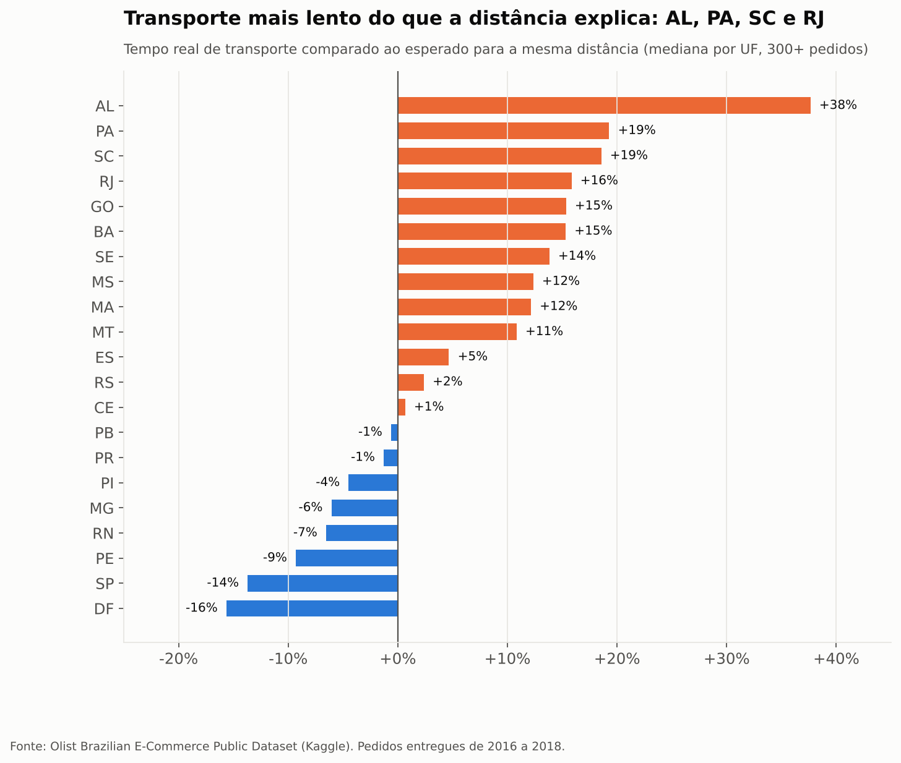
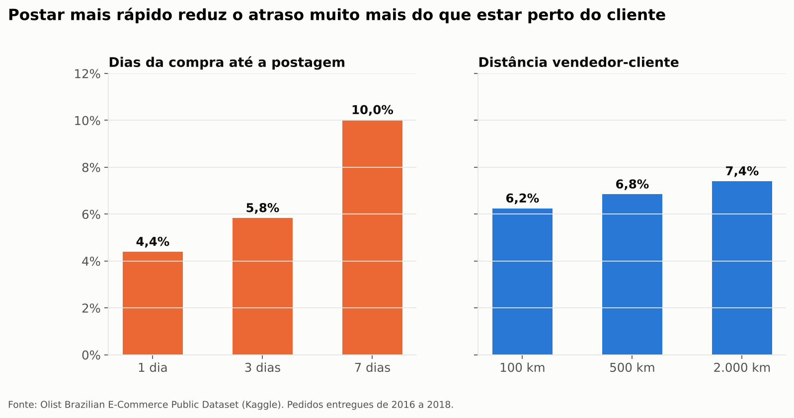
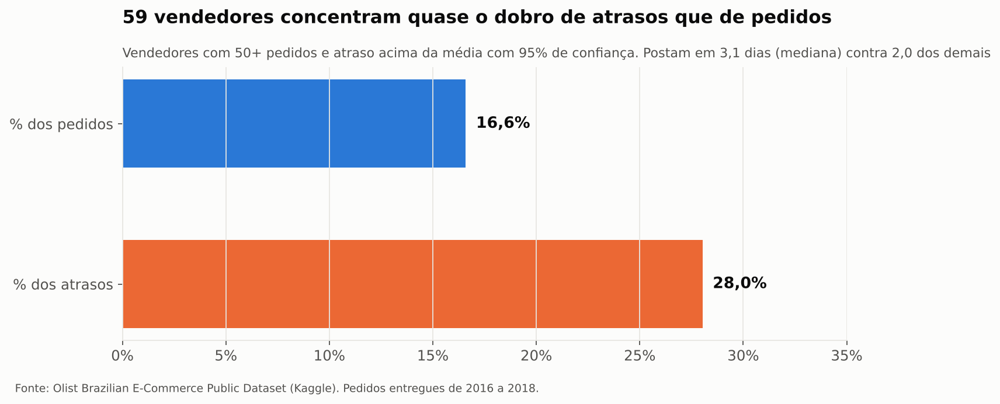
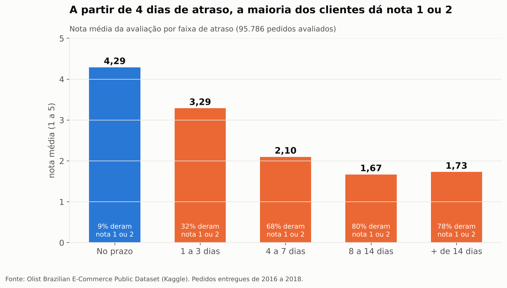
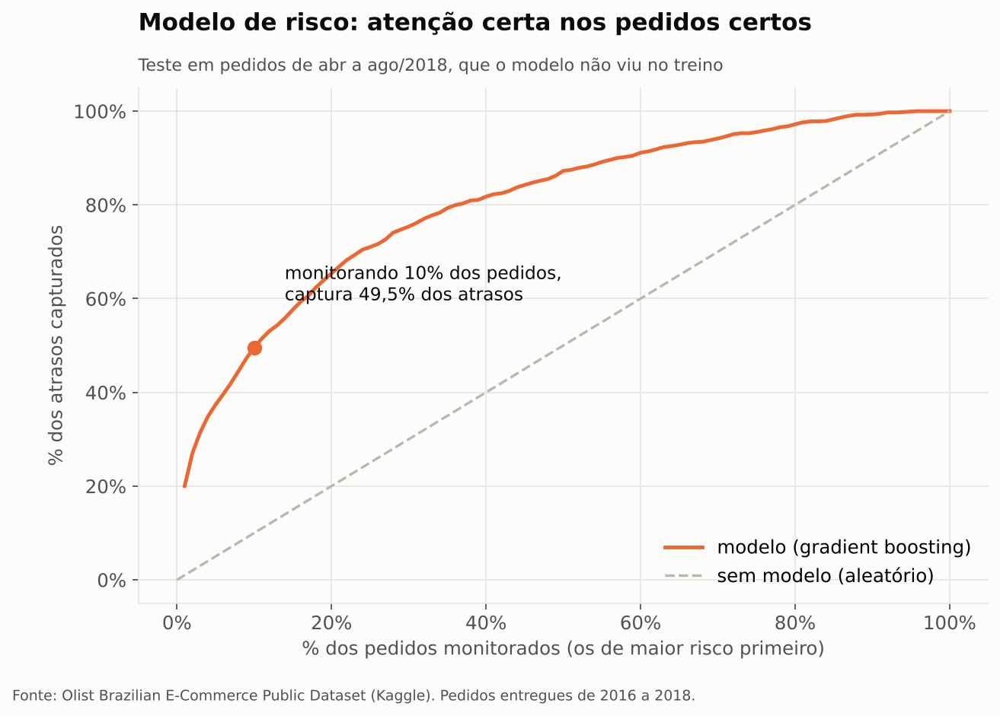

<h1 align="center">Entregas no e-commerce brasileiro: onde e por que os pedidos atrasam</h1>

<p align="center">Análise de 96 mil entregas reais da Olist com <b>SQL, Python, estatística e um modelo de risco de atraso</b>.</p>

<p align="center">
<a href="https://luiscarlossoarespro-cyber.github.io/olist-logistica-entregas/dashboard/"></a>
<a href="https://luiscarlossoarespro-cyber.github.io/"></a>
<a href="https://www.linkedin.com/in/luiscarlos-log/"></a>


</p>

**Demonstração do dashboard em uso (1 min 53 s):**

https://github.com/user-attachments/assets/0a9449b6-2f8d-4fa7-b8d8-5025ad2fe5f4

[](https://luiscarlossoarespro-cyber.github.io/olist-logistica-entregas/dashboard/)

## Dashboard interativo

**[Abrir o dashboard](https://luiscarlossoarespro-cyber.github.io/olist-logistica-entregas/dashboard/)**: filtros por período, região, UF e categoria recalculam tudo na hora. São 9 abas:

| Aba | O que responde |
|---|---|
| Visão geral | 12 indicadores (entregas no prazo, atraso com margem de erro, prazos com média, mediana e P90, nota, faturamento, frete), tendência mensal, ranking por UF e plano de ação |
| Perguntas do gerente | 10 perguntas de uma liderança de operação, respondidas com os números da análise |
| Vendas | Faturamento, ticket médio, ranking de categorias, UFs e vendedores (quem vende mais e menos) |
| Regiões e rotas | Mapa origem x destino, rotas críticas, chance de atraso por região, transporte real x esperado, promessa x P90 |
| Prazo e operação | Média x mediana x P90 por etapa, composição do prazo por mês, postagem x distância, dia da semana |
| Vendedores | Curva de Pareto e scorecard com teste estatístico |
| Satisfação | Nota por faixa de atraso e por categoria |
| Risco de atraso | Curva de captura, faixas de risco (previsto x real), variáveis mais importantes |
| Qualidade e método | Auditoria dos dados, definições e limitações |


---

## Resumo executivo

**Pergunta de negócio:** quanto os pedidos atrasam, em que etapa o tempo se perde, o que explica o atraso e quanto ele custa em satisfação do cliente?

| Indicador | Valor |
|---|---|
| Pedidos entregues analisados (após auditoria) | **96.432** |
| Pedidos entregues depois do dia prometido | **6,8%** (IC 95%: 6,6% a 6,9%) |
| Prazo prometido (mediana) | 23,2 dias |
| Prazo real (mediana) | 10,2 dias |
| Nota média do cliente | 4,16 |

**Os 5 achados principais**

1. **O atraso tem picos, não é constante.** Fora dos picos, ficou entre 1,2% e 7,5% ao mês, mas chegou a **12,4% na Black Friday de 2017** e a **19,0% em março de 2018**. Nos picos, quem mais piorou foi o **transporte**.
2. **Região pesa mais que distância.** Com distância, peso, tempo de postagem e mês iguais, **RJ e Nordeste têm cerca de 3 vezes a chance de atraso de SP**. A distância sozinha muda pouco: de 6,3% (100 km) para 7,4% (2.000 km).
3. **O tempo até postar é a maior alavanca do vendedor.** Postando em 1 dia, o atraso previsto é **4,4%**. Em 7 dias, sobe para **10,0%**.
4. **Há vendedores que concentram atraso.** **59 vendedores** atrasam acima da média com 95% de confiança: têm 16,6% dos pedidos e **28,0% dos atrasos**, e postam mais devagar (3,1 contra 2,0 dias).
5. **O cliente tolera pouco atraso.** A nota cai de 4,29 (no prazo) para 3,29 (1 a 3 dias) e para cerca de 1,7 (8 dias ou mais), quando **78% a 80% dos clientes dão nota 1 ou 2**.

**Recomendações com impacto estimado**

| Ação | Impacto estimado |
|---|---|
| Monitorar diariamente os 10% de pedidos com maior risco (modelo deste projeto) | Captura **49,5% dos atrasos** antes de acontecerem (5 vezes melhor que ao acaso) |
| Plano com os 59 vendedores críticos: meta de postagem em até 2 dias | Atua sobre **28% dos atrasos** concentrados em 17% dos pedidos |
| Rever transportadoras e rotas das UFs de maior atraso (AL, MA, SE, PI, CE, BA, RJ, PA e ES) | Se o atraso dessas UFs caísse ao nível das demais: **1.602 atrasos a menos** (24,5% do total; 1,7 ponto percentual no índice geral) |
| Reforçar capacidade antes de picos (Black Friday) | Evita meses como nov/17 (12,4%) e fev a mar/18 (14% a 19%) |

> As relações acima são de **associação**, não de causa: a base não informa transportadora, clima, greves ou estoque. As estimativas de impacto são cenários, não promessas.

---

## Perguntas do gerente (respostas da base completa)

| Pergunta | Resposta |
|---|---|
| Qual é a taxa de entrega no prazo? | 93,2%. Os outros 6,8% atrasam (6.533 pedidos). |
| Qual rota mais gera atraso? | SP → RJ: 8.156 pedidos, 14,1% atrasados, 17,6% de todos os atrasos. |
| Em que etapa perdemos mais tempo? | No transporte: 27,9 dias nos pedidos atrasados contra 8,0 nos pedidos no prazo. |
| Quanto o atraso custa em satisfação? | A nota cai 2,02 pontos. Cerca de 3.391 notas 1 ou 2 a mais estão associadas ao atraso (27,7% das avaliações negativas). |
| A promessa de prazo está correta? | Em 12 UFs o prazo prometido fica abaixo do P90 real (risco). Em SP dá para prometer menos: 18,7 dias contra P90 de 15,8. |
| Dá para prever atrasos? | Sim: os 10% de maior risco concentram 49,5% dos atrasos (21,9% atrasam, contra 1,6% na faixa baixa). |
| Quem vende mais tem mais atraso? | O maior vendedor fatura R$ 226.988 e está entre os críticos, com 10,5% de atraso. |

Todas as respostas são calculadas por [`src/10_dados_dashboard.py`](src/10_dados_dashboard.py) e salvas em [`resultados/10_perguntas_do_gerente.csv`](resultados/10_perguntas_do_gerente.csv).

---

## Dados e qualidade

- **Fonte:** [Brazilian E-Commerce Public Dataset by Olist](https://www.kaggle.com/datasets/olistbr/brazilian-ecommerce) (Kaggle): 9 tabelas, cerca de 100 mil pedidos de 2016 a 2018.
- **Auditoria antes da análise** ([`resultados/01_auditoria_qualidade.csv`](resultados/01_auditoria_qualidade.csv)):

| Verificação | Ocorrências | Decisão |
|---|---|---|
| Pedidos com status "entregue" | 96.478 | universo da análise |
| Entregues sem alguma das 3 datas (aprovação, postagem, entrega) | 23 | excluídos |
| Entregue ao cliente **antes** da postagem (impossível) | 23 | excluídos |
| Postado antes da aprovação do pagamento | 1.350 (1,4%) | mantidos (registro tardio do pagamento) |
| Pedidos com mais de um vendedor | 1.278 (1,3%) | vendedor de referência = primeiro item |
| Produtos sem categoria | 610 (1,9%) | "sem_categoria" |
| Coordenadas fora do Brasil (geolocalização) | 31 | excluídas antes de calcular a distância |
| Pedidos entregues sem avaliação | 646 (0,7%) | fora só das análises de nota |

**Definição de atraso:** o pedido chegou em **dia posterior** ao dia prometido. A data prometida não tem horário. Por isso, comparar por horário (como na versão 1 deste projeto) marcava como atrasada a entrega feita **no próprio dia prometido** e inflava o índice para 8,1%. A definição correta dá **6,8%**.

---

## Metodologia

| Etapa | O que foi feito | Arquivo |
|---|---|---|
| 1. Auditoria | Nulos, duplicados, datas impossíveis, cobertura temporal e geográfica | [`src/01_auditoria.py`](src/01_auditoria.py) |
| 2. Base analítica | 1 linha por pedido, com etapas do prazo, distância vendedor-cliente (haversine pelo centro do CEP), peso, frete, categoria e nota | [`sql/01_geo_prefixo.sql`](sql/01_geo_prefixo.sql), [`sql/02_base_entregas.sql`](sql/02_base_entregas.sql) |
| 3. Descritiva | Taxas com intervalo de confiança de 95% (Wilson) por mês, UF, distância, categoria e faixa de atraso | [`src/03_descritiva.py`](src/03_descritiva.py) |
| 4. Inferência | Regressão logística com controles, transporte real x esperado pela distância, impacto na nota (Mann-Whitney e regressão), vendedores acima da média | [`src/04_inferencia.py`](src/04_inferencia.py) |
| 5. Modelo | Previsão de risco na postagem; validação temporal (treino até mar/18, teste abr a ago/18) | [`src/05_modelo.py`](src/05_modelo.py) |
| 6. Comunicação | Gráficos e relatório técnico | [`src/06_graficos.py`](src/06_graficos.py), [`src/08_relatorio.py`](src/08_relatorio.py) |
| 7. Análises de operação | Percentis e SLA, promessa x P90, rotas, dia da semana, Pareto, notas negativas, faixas de risco | [`src/09_analises_extra.py`](src/09_analises_extra.py) |
| 8. Dashboard | Dados agregados para os filtros e o dashboard interativo | [`src/10_dados_dashboard.py`](src/10_dados_dashboard.py), [`dashboard/`](dashboard/) |

Detalhes técnicos e tabelas completas: [`docs/RELATORIO_TECNICO.md`](docs/RELATORIO_TECNICO.md). Colunas da base: [`docs/DICIONARIO_DE_DADOS.md`](docs/DICIONARIO_DE_DADOS.md).

---

## Resultados

### 1. Quando: picos de atraso


Na Black Friday de 2017 o volume subiu 63% em relação a outubro: a postagem passou de cerca de 2,3 para 3,2 dias (mediana) e o transporte de 7 para 8,8 dias. Em fevereiro e março de 2018 a postagem ficou normal, mas o **transporte** subiu para 11,0 e 9,9 dias. O problema foi logístico, não do vendedor. Em agosto de 2018 o prazo prometido caiu para 13,4 dias (mediana) e o atraso voltou a subir, mesmo com a entrega mais rápida da série.

### 2. Onde: UF do cliente


### 3. Região x distância: o que pesa de verdade


O RJ tem distância mediana de só 394 km (66% dos pedidos vêm de vendedores de SP) e mesmo assim atrasa 12,1%. No modelo com controles, a chance de atraso do RJ é **3,0 vezes** a de SP (IC 95%: 2,8 a 3,3).



Comparando o tempo real de transporte com o esperado para a mesma distância, **AL (+38%), PA, SC (+19%) e RJ (+16%)** são mais lentos do que a distância explica. SP e DF são mais rápidos (-14% e -16%).

### 4. Alavanca do vendedor: postar rápido


Pedidos atrasados levaram em média 6,1 dias até a postagem (no prazo: 3,0) e **27,9 dias no transporte** (no prazo: 8,0). O transporte é onde mais tempo se perde, mas a postagem é a parte que o vendedor controla.

### 5. Vendedores críticos


Entre 419 vendedores com 50 ou mais pedidos, 59 têm atraso acima da média com 95% de confiança. Lista completa: [`resultados/04_vendedores.csv`](resultados/04_vendedores.csv).

### 6. Custo na satisfação


Atrasar derruba a nota em **2,0 pontos** em média (IC 95%: 1,98 a 2,06; Mann-Whitney p < 0,001). Controlando distância, região e mês, só o fato de atrasar tira 1,46 ponto, e cada dia a mais tira outros 0,06.

### 7. Modelo de risco de atraso


| Modelo (teste: abr a ago/2018) | ROC-AUC | PR-AUC | Atrasos capturados nos 10% de maior risco | Precisão nos 10% de maior risco |
|---|---|---|---|---|
| Gradient boosting | 0,816 | 0,384 | **49,5%** | 21,9% |
| Regressão logística | 0,816 | 0,257 | 44,3% | 19,6% |
| Sem modelo (aleatório) | 0,500 | 0,044 | 10,0% | 4,4% |

As variáveis mais importantes são o **prazo que sobra no momento da postagem**, os **dias até postar** e a **distância**. O modelo usa só o que se sabe até a postagem (nada da entrega), para não "vazar" a resposta.

### Outros resultados
- **Categoria do produto explica pouco:** entre as 26 categorias com 500 ou mais pedidos, o atraso vai de 4,3% a 8,2%. A exceção em prazo é `office_furniture`: 18,9 dias (mediana), nota 3,65 e peso mediano de 11,9 kg.
- **A promessa é folgada, mas desigual:** a folga mediana é de 11,9 dias. Ainda assim, em AL, 24% dos pedidos estouram o prazo (por horário).

---

## Limitações

- Um único marketplace, de 2016 a 2018: serve para o método, não para descrever a logística de hoje.
- A base não informa transportadora, rota, clima, greves ou estoque. As conclusões são de associação.
- A distância é em linha reta, entre o centro dos prefixos de CEP, e não pela estrada.
- A nota só existe para quem avaliou (possível viés de resposta).
- O modelo foi testado num período com menos atraso (4,4%) que o treino (8,0%). Em uso real, precisaria de monitoramento e retreino.

## O que mudou da versão 1

- Definição de atraso corrigida (por dia, não por horário): 8,1% passou para 6,8%.
- 23 pedidos com datas impossíveis excluídos.
- Novos: distância vendedor-cliente, intervalos de confiança, regressão com controles, análise de vendedores com teste estatístico, modelo de risco com validação temporal e cenários de impacto.
- A conclusão "o atraso é espalhado entre vendedores" foi refinada: existe um grupo de 59 vendedores que concentra 28% dos atrasos.

---

## Como reproduzir

```bash
pip install -r requirements.txt
# baixe os 9 arquivos .csv do Kaggle para a pasta dados/
python src/rodar_tudo.py
```

O script roda todas as etapas em ordem e recria `resultados/`, `graficos/`, o relatório técnico e os dados do dashboard. Para ver o dashboard localmente, abra `dashboard/index.html` no navegador.

```
sql/          base analítica em SQL (DuckDB)
src/          etapas do projeto em Python (01 a 07) e rodar_tudo.py
resultados/   todas as tabelas geradas (CSV)
graficos/     gráficos do relatório (PNG)
docs/         relatório técnico e dicionário de dados
dashboard/    dashboard interativo (index.html + dados.js)
```

**Ferramentas:** SQL (DuckDB), Python (Pandas, SciPy, statsmodels, scikit-learn, Matplotlib, Plotly). Desenvolvido com apoio de IA (Claude) na escrita do código.

## Fonte e licença

- **Dados:** Olist, [Brazilian E-Commerce Public Dataset](https://www.kaggle.com/datasets/olistbr/brazilian-ecommerce), licença [CC BY-NC-SA 4.0](https://creativecommons.org/licenses/by-nc-sa/4.0/). Os dados brutos não estão neste repositório. Gráficos e tabelas resumidas seguem a mesma licença (uso não comercial, com atribuição à Olist).
- **Código:** licença MIT ([`LICENSE`](LICENSE)).

---

<p align="center">
<b>Luis Carlos Machado Soares</b> · Análise de dados aplicada à logística<br>
<a href="https://www.linkedin.com/in/luiscarlos-log/">LinkedIn</a> · <a href="https://luiscarlossoarespro-cyber.github.io/">Portfólio</a> · <a href="https://github.com/luiscarlossoarespro-cyber">GitHub</a>
</p>
